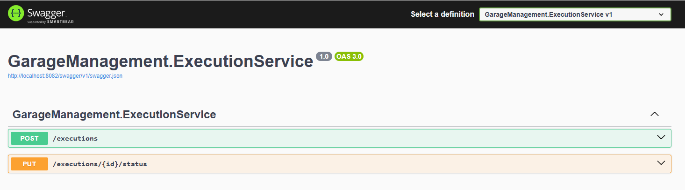

# Execution Service

O Execution Service gerencia a execução operacional da OS:

- criação da fila de execução;
- diagnóstico;
- reparo;
- finalização da execução;
- publicação de `ExecutionCompleted` com o mesmo `correlationId` da Saga.

Endpoints principais:

- `POST /executions`
- `PUT /executions/{id}/status`
- `GET /health`

Status permitidos:

```text
Queued
InDiagnosis
InRepair
Completed
Canceled
```

O serviço não acessa os bancos do OS Service ou do Billing Service. Sua
integração ocorre por API e RabbitMQ.

## Documentação da Arquitetura do Service

Documentação:

- [Arquitetura dos microsserviços e da Saga](https://github.com/kmlyteixeira\garage-management-contracts\docs\saga-service-order-flow.md)

Fluxo resumido:

```text
Saga no OS Service
        |
        | POST /executions
        v
Execution Service
        |
        | MongoDB: Queued -> InDiagnosis -> InRepair -> Completed
        v
RabbitMQ: ExecutionCompleted
        |
        v
Saga atualiza OS para Finished
```

## Banco de Dados escolhido

**MongoDB (NoSQL documental)**, em instância privada do serviço.

Justificativa:

- cada execução é um documento independente;
- o fluxo é orientado a mudanças de status e histórico operacional;
- o serviço não precisa de joins com clientes, veículos ou orçamentos;
- MongoDB permite evolução do documento de execução sem acoplamento ao modelo relacional dos demais bounded contexts.

## Caminhos para Dockerfiles e manifestos Kubernetes

- Dockerfile: [Dockerfile](./Dockerfile)
- Manifestos Kubernetes: [k8s/](./k8s/)
- Deployment e Service: [k8s/deployment.yaml](./k8s/deployment.yaml)
- Kustomize: [k8s/kustomization.yaml](./k8s/kustomization.yaml)
- Infraestrutura Terraform: [infra/](./infra/)
- Repositório de Infraestrutura: [garage-management-infra](https://github.com/kmlyteixeira/garage-management-infra)


## Evidência de cobertura de testes

O projeto possui testes automatizados com foco nos **domínios críticos**.


Testes automatizados:

- [tests/](./tests/)
- [GarageManagement.ExecutionService.Tests.csproj](./tests/GarageManagement.ExecutionService.Tests.csproj)

## Swagger

Em execução local:

```text
http://localhost:8082/swagger
```


